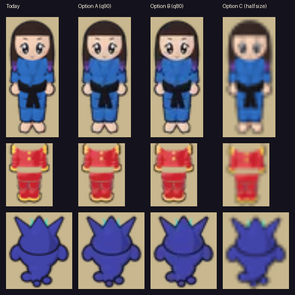

# Download size options (Nov 26)

Follows `download-size-2026-11-25.md`. **Nothing is switched on: Jay picks.** Measured by re-packing a copy of every art page (`tools/size-options/measure.py`); the game's art is untouched.

## Where we are

The art has grown since Nov 25 (the Loom Keeper's new animations): **252.8 MB of art today**, so the phone app would be about **263 MB** (art plus about 10 MB of sound and code). Apple asks before downloading an app over 200 MB on mobile data.

## The options

| | What changes | Art | Phone app (about) | Looks |
|---|---|---|---|---|
| Today | | 252.8 MB | 263 MB | |
| **A** | Art packed with gentle "lossy" squeezing (quality 90). One pack already uses this. | **199.7 MB** (−21%) | **210 MB** | Same as today in the side-by-side |
| **B** | Stronger squeezing (quality 80) | **174.7 MB** (−31%) | **185 MB** | Same as today at phone size; tiny speckles only when zoomed in a lot |
| **C** | Art pages at half size on phones (the game draws them twice as big) | **94.4 MB** (−63%) | **105 MB** | **Clearly softer**: faces, belts and outlines blur |
| C + A | Half size and quality 90 together | 81.7 MB (−68%) | 92 MB | Soft, like C |

Side-by-side (enlarged 3 times, about how a phone draws a character in a fight): `size-options/side-by-side.png`. From left: today, A, B, C.

Why C is blurry: phones already draw the characters bigger than the art's own pixels (a hero frame is 96 pixels tall but shows about 380 pixels tall on an iPhone), so halving the pixels shows straight away.

## Also worth knowing

- **Load each belt's monsters on first use (the app's version of "load art per tier").** Today only the Orange monsters (about 21 MB) would wait for the first Orange climb. It saves more with every new belt (each adds 20–30 MB), so it matters more later. It needs a file host for the app to fetch from, so it fits with the server milestone.
- **Extra looks on first use** (hair, outfits, hats: about 125 MB) is still the biggest saving, from the Nov 25 note. It also needs a file host.
- Where the art goes now: monsters 80 MB (the two Loom Keeper forms are 28 MB), hair 68 MB, outfits 36 MB, hats and back pieces 22 MB, other player art 18 MB, everything else 18 MB, kata 11 MB.

## Claude's suggestion

**A now**: it gets the app close to the 200 MB line with no visible change, and it's one setting in the art import step (`webpQuality: 90` on each pack). Add **B** if Jay sees no difference on his phone. Skip C. Plan "per belt" and "looks on first use" with the server milestone.

To switch one on later: set `webpQuality` on the packs in `tools/art-import/approved.json` and re-run the import (`tools/art-import/README.md`). Any new art from then on stays small.

To measure again: `python tools/size-options/measure.py <folder>`, then `python tools/size-options/compare.py <folder> <picture.png>`.
