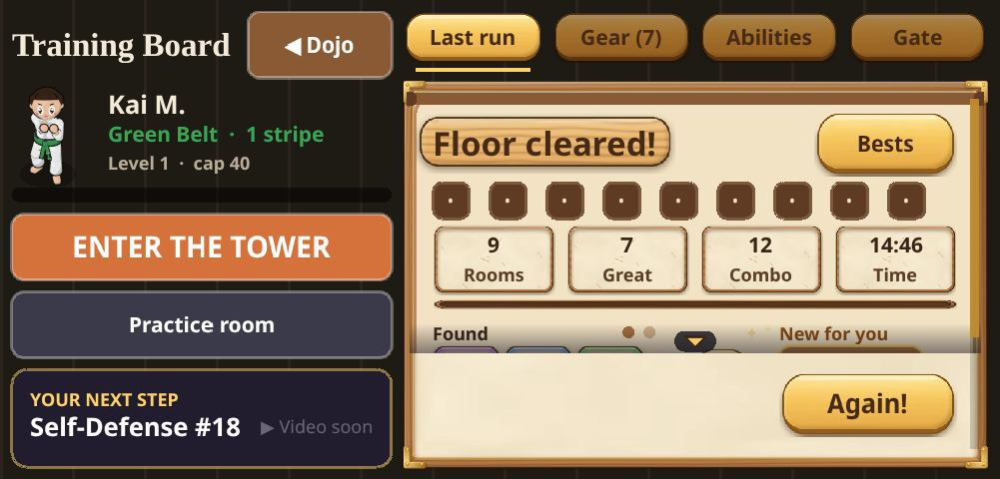
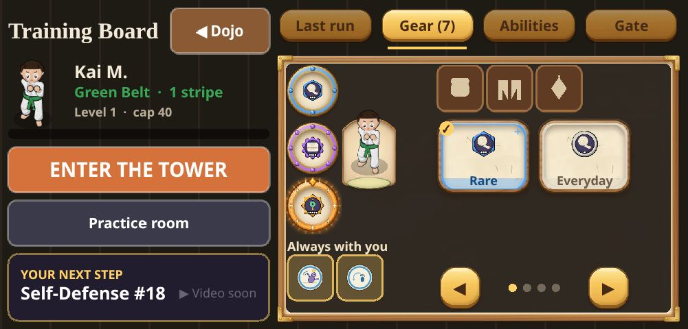

# Q-PREMIUM-PASS: premium quality audit (main 69c3abaf)

## Delivery Note

- **ITEM:** Q-PREMIUM-PASS. Premium quality audit of main `69c3abaf`, Sat Oct 31 2026 (ET). No code was written.
- **WHAT:** I played every screen I could reach on a phone-shaped browser (real touch, DPR 1.5) at 667x375, 844x390 and 667x320, with reduced motion on and off. The Board was checked at all 6 size and motion combinations. The other screens were checked at 667x375 with reduced motion off. 22 findings below, ranked High, Medium and Low. The Board has a full redesign proposal and a mockup.
- **WHY:** Jay says the in-game "board" looks messy. He is right. It is the **Training Board** (the Dojo's "Board" button). It has about 12 things on the left, 4 tabs with 3 different frame styles, text from 10 px to 30 px, and it clips at 667x320.
- **DECIDE:** (1) Approve the Board redesign in section 1 (one frame style, 3-thing left column, big icon tabs, named gear). (2) Pick which Medium items ride with it: I suggest M1 (first-visit modals), M2 (title) and M4 (loudness). (3) Say whether "Video soon" should hide until videos exist.
- **NEXT:** A code job for the Board redesign (it fixes H1 to H4 and L3 together). Then a second pass of the same checks on the result. Still open for a later pass: the Keeper boss fight, the lose screen, the levels-gained moment, and listening to the sounds (see "Not covered").

How I tested: local dev build of `69c3abaf`, fixtures from `fixtures/`, a seeded profile to fill the Gear and Last run tabs. Screenshots are JPEGs in `premium-pass/shots/`. Frame times were measured in the page over 3 s windows.

Design-rule check: Power Rating appears **only** on the hidden testing screen (it never appeared in any text dump of any other screen). No purchases, chat, ads or guilt wording was found.

---

## 1. PRIORITY ONE: the "board" screen

### Which screen Jay means

I searched code and UI for "board". Candidates, most likely first:

1. **Training Board** (`HomeScene.ts`). Dojo top-right button "Board", then a screen titled "Training Board". It is the hub with Enter the Tower, Practice room, Next step, and 4 tabs (Last run, Gear, Abilities, Gate). **This is the one.** It is the screen every kid opens after every run, it is the busiest, and "board" is its name in both the button and the title.
2. **Gear tab** of the Board. The most crowded tab, with unnamed items.
3. **Abilities tab** (Trophy Case and Fighting Style). Tiny belts, empty kata icons, clipped card text.
4. **Gate tab**. Cleaner, but a third frame style.
5. The wall "BOARD" sign in the Home Dojo and the "Board" button label. This is only a word; it is not a screen. (Its text also sits at y=-132 off-screen in the Dojo text dump, so check it is not a stray label.)

I audited 1 to 4 below. The redesign applies to all of them.

### What is wrong (Training Board, 667x375)

Left of the picture is the real game with problems numbered. Right is the proposed layout (a sketch, not game art).

1. **Hierarchy is flat.** Title, Dojo button, avatar, level bar, Play, Practice room and Next step all have similar weight. A 6-year-old has to read everything to find "play". Play is the biggest thing but sits third.
2. **The player card is tiny.** Avatar about 30 px, the level bar is empty and nearly black, and "cap 40" is adult jargon that means nothing to a child.
3. **Practice room and Next step look as loud as Play.** Three stacked, full-width, rounded rectangles in the same dark colour.
4. **A placeholder is on the main screen.** "▶ Video soon" appears next to "Self-Defense #18". Kids read it as a broken button.
5. **Tabs are small and text-only.** 12 to 14 px, no icons. "Abilities" and "Gear (7)" are hard for a non-reader to tell apart.
6. **Three different frame styles across the four tabs.** Last run is a parchment frame with brown tiles. Gear is a dark frame with gold. Abilities is tan cards. Gate is a dark rounded panel with blue circles. The screen changes style when you change tab, which reads as "messy".
7. **Text sizes jump around.** Seen on one screen: 10, 12, 13, 14, 17, 19, 22 and 30 px. Most of the right panel is 12 px.
8. **Two big buttons fight each other on Last run** ("Bests" top right, "Again!" bottom right), plus a small play arrow and a "New for you" tile. Four calls to action in one 300 px panel.
9. **Content hidden by size.** At 667x320 the Last run "Found" row is cut off by the Again! button (it is partly behind a fade), Gear shows only 2 of 4 gear cards, kata names wrap to 3 lines ("David and Goliath").

Per tab:

- **Last run:**  Nine empty dots, four stat tiles, "Found", "Always with you", "New for you", two buttons. Too much for one panel.
- **Gear:**  Gear is shown only by a rarity word (Everyday, Special, Rare, Epic). No item names, no "what does it do". See H3.
- **Abilities / Fighting Style:**  "Beginner's Stance" is written 3 times. Card text is clipped at the bottom ("Beginner's Stance", "Shield of Respect"). "Always with you" has 7 tiny circles.
- **Gate:**  The cleanest tab. Labels are 12 px, "SD #16" is unexplained, "Kick 4" is unclear.

### Redesign proposal

**Rule of the screen:** the left column says *who I am and PLAY*. The right panel says *what I have*. Nothing else.

Left column (about 38% of the width):
- **Back button** "◀ Dojo": top-left, 44 px tall, quiet colour. Drop the "Training Board" title (the tab tells you where you are), or keep it very small.
- **Player card:** one rounded card with a 64 px avatar, name at 20 px, belt line at 16 px, and one thick level bar (14 px tall, gold fill) with "Level 1" at 16 px. **Remove "cap 40".**
- **ENTER THE TOWER:** 72 px tall, orange, 24 px text. The only loud button on the screen.
- **One row of two quiet buttons:** "Practice" and "Next lesson". They are half width each and the same dark colour. "Next lesson" shows the lesson name only; hide the "Video soon" until a video exists.

Right panel (about 62%):
- **Tab bar:** 4 tabs, 44 px tall, each with an icon and a label of 16 px or more: Last run (flag), Gear (shield), Skills (star), Gate (door). Rename "Abilities" to "Skills".
- **One panel style for all 4 tabs** (dark parchment with a gold edge). The parchment of Last run becomes the shared style.
- **Minimum text 15 px** everywhere; headers 22 px.
- **Last run:** "Floor cleared!" 24 px, then 3 tiles (Rooms, Great, Time; drop Combo to the Bests screen), then "You found" with item **names** under the icons, then one big "Play again" button. "Bests" becomes a small text link under the panel. The 9 dots become a single line, "9 of 9 rooms".
- **Gear:** 3 big slot cards (Hands, Gi, Charm). Each shows the item name, a coloured rarity tag and one line of what it does ("+4% Power" in kid words, e.g. "Hits a bit harder"). Tap a card for the list. "Always with you" moves to the Skills tab (it is shown twice today).
- **Skills:** Trophy Case and Fighting Style become two big toggle buttons at 16 px. Stance card names get 2 lines max and are not clipped.
- **Gate:** keep, but 14 px labels, replace "SD #16" with the lesson's short name or an icon, and keep the lock row.
- **Small phone (667x320):** the right panel must fit without a scroll. Use a 2-column Gear layout of 3 cards and cut Last run to 3 tiles plus one button. Test all four tabs at 667x320 as the acceptance check.
- **Motion:** with reduced motion on, the sparkle next to "New for you" is already removed. Keep that.

Acceptance: 4 tabs x 3 sizes x motion on/off, no text under 14 px (Gate row labels excepted), nothing clipped, one frame style, Play the biggest and first thing a kid sees.

---

## 2. Findings

### HIGH

**H1. The Training Board is crowded and uneven (priority one).**
Shot: 
Wrong: see section 1 (items 1 to 8).
Kids: a 6-year-old cannot find "play" fast, and the screen is the one they see after every fight.
Fix: the layout proposal in section 1.

**H2. Board clips content at 667x320.**
Shot:  
Wrong: on Last run the "Found" row and "New for you" are cut by the Again! button. On Gear only 2 of 4 gear cards and 3 of 4 slot icons show. Kata names wrap to 3 lines ("David and Goliath"): .
Kids: loot is the reward for a run; it is the part they cannot see on a smaller phone.
Fix: design the panel for 320 px first (fewer tiles, one button), as in section 1.

**H3. Gear shows a rarity word, not a name or an effect.**
Shot: 
Wrong: cards read "Rare", "Everyday", "Epic", "Special". The item name (Mountain Gi, Jade Charm) and what it does only appear after a tap, and only in small text. The 3 round icons on the left and the 4 small circles under "Always with you" have no labels. An earlier Q-PREMIUM finding (Gear text cut off) is partly still there.
Kids: a child cannot tell what they are wearing. Equipping feels random.
Fix: show the item name and a one-line effect on every card; move "Always with you" to the Skills tab.

**H4. Fight screen: 40% of the width is round buttons and the HUD stacks in the corner.**
Shot: 
Wrong: five round buttons (STRIKE, COUNTER, DASH, VIRTUE, STANCE) at 12 to 17 px labels fill the right side; the hero and enemy are about 30 px tall on a 375 px screen. The Sensei hint box (two lines) covers the lower left. At t0 the Bow button sits on the enemy's spot. "GREAT!" at 54 px covers the enemy .
Kids: the first fight is the first impression, and the thing they are fighting is hard to see.
Fix: move VIRTUE and STANCE into a smaller secondary group, make "GREAT!" smaller (about 32 px) and put it above the hero, zoom the camera in 10 to 15% so the hero and enemy are bigger.

### MEDIUM

**M1. First-visit modals stack up (Title, then the Dojo).**
Shot:  
Wrong: the title opens with a 4-paragraph "Saved on this phone" box. In the Dojo, a 3-card "How do you like to train?" chooser covers the screen and the Music/Sound/Reduced motion row is jammed against the bottom edge. A third modal (decoration help) follows. This was an earlier finding and is **still open (3 modals)**.
Kids: a child taps "OK" on everything without reading, and may pick a difficulty by accident.
Fix: show one modal at a time, spaced out. Move the privacy text behind "For grown-ups". Show the difficulty chooser on the Board the first time Enter the Tower is pressed.

**M2. Title screen is plain and shows a debug version line.**
Shot: 
Wrong: black background, a white serif title and "Tap to start". "Version: Oct 31, 7:42 AM" in tiny type top-left (still open from the earlier pass; it may be dev-only, please check the release build).
Kids: no art, no character, no sound cue. The first screen feels unfinished.
Fix: put the hero and a dojo backdrop behind the title, gently pulse "Tap to start" (still when reduced motion is on), hide the version outside dev.

**M3. Character creation controls are tiny.**
Shot: 
Wrong: skin, hair and gi colour circles are about 16 px. The hairstyle row is 12 dots. Hit areas are far under a finger.
Kids: small fingers miss and pick the wrong colour.
Fix: 36 to 44 px swatches in 2 rows, hairstyle as 4 to 6 big tiles or a bigger arrows control.

**M4. Sound loudness is uneven (from `content/settings/sfx.json`).**
Shot:  (Music/Sound steppers; sound defaults to 5 of 5)
Wrong: gains run from -20.7 dB to +3.3 dB. Whoosh and dash cloth sounds are +2.7 and +3.3 dB while strike is -5 dB and hit about -8 dB. So a whoosh is louder than a punch, and it plays all the time. The "insight" power-up is -16.5 dB. Promotion is +0.5 dB. I could not listen on the box, so this is from the numbers only.
Kids: the loudest sound is the least important one. Sound defaults to full.
Fix: bring whoosh and dash to about -8 dB, lift insight to about -8 dB, set the Sound default to 3 of 5, and listen at phone speaker volume.

**M5. The Board's "Video soon" placeholder.**
Shot: 
Wrong: "▶ Video soon" shows beside the next lesson on every tab. Earlier "Kata (its reward arrives in a later update)" text was not seen this time.
Kids: looks like a broken play button.
Fix: hide until a video exists, or show a lock with "Coming soon" only in the grown-ups gate.

**M6. Abilities: card text clipped and kata icons empty.**
Shot:  
Wrong: the kata cards ("Basic Form 1", "Basic Form 2", "Keon") show a plain gold circle where an icon should be. Belts in the Trophy Case strip are tiny (an earlier finding, still open). Stance and Virtue names are cut at the bottom of the card.
Kids: empty circles look like missing art.
Fix: a simple placeholder icon per kata, a bigger belt strip, and 2-line max names with a bigger card.

**M7. Fight: the "HOME" door label floats inside the arena and collides with loot text.**
Shot: 
Wrong: "HOME" (13 px) drifts across the floor as the camera moves, and the loot toast "Rare: Mountain Gi" lands on top of it. "Room 1 of 8 · Wave 3 of 3" stays after the last enemy dies, so it reads as an unfinished fight.
Kids: confusing words on the floor; "Wave" and "Room" are two counters.
Fix: pin the door label to the door only and hide it while enemies are alive; stack loot toasts under the HUD; show one counter ("Room 1 of 8") and hide "Wave" when no enemy is left.

**M8. Welcome-home overlay is off-centre and the number is odd.**
Shot: 
Wrong: "Welcome home, Kai! You've already earned these in the dojo. 29 things to unlock!" The hero is drawn behind the text, "Tap to continue" is tiny at the bottom, and "29 things to unlock!" is a big unexplained number with no way to see them. It is a count to chase, so it edges toward pressure.
Kids: a big number with no meaning.
Fix: centre the hero above the text, drop the number, and say "Look at your new things!" with a button to the Gear tab.

**M9. Decorate: hint text collides with the heading.**
Shot:  
Wrong: in the "How do you like to move decorations?" modal, "Tap a decoration to pick it" is drawn on top of the heading. In the placement view, "Now tap where it should go" is white text on the busy floor with a thin outline and covers the wall items. "BOARD" on the wall is 10 px.
Kids: the instruction is the hardest thing to read.
Fix: a solid dark pill behind the hint, 16 px, at the bottom; remove the overlap in the modal.

### LOW

**L1. Street Smarts start screen is very empty.**
Shot: 
Wrong: "Who are you at the store with?" with two buttons in a large black screen, a "Sound on" button top right. It looks like a form.
Fix: add the Sensei and a store backdrop; larger buttons. Keep the question.

**L2. Dojo home labels are tiny.**
Shot: 
Wrong: "TOWER" is 11 px at the door, "BOARD" 10 px on the wall, the 4 top buttons are 14 px. The player stands on the Tower mat. Home Dojo and "✓ Spotless" in the top-left are 13 to 20 px serif on busy wood.
Fix: 14 px minimum for door and sign labels; a dark pill behind them.

**L3. Jargon in small text.**
Shot: 
Wrong: "cap 40", "SD #16/#17/#18", "Kick 4", "Time in rank", "Sensei's Seal" (the explanation is 12 px: "Lights when Sensei approves you to test."), "Room 1 of 8 · Wave 3 of 3", "Training Points" (hidden screen only).
Fix: use the lesson's short name, drop "cap", and say "Classes with Sensei: 15 of 24".

**L4. Town, Outside and Inside look good; labels are small.**
Shot:   
Wrong: Town has a small "Home" button and building labels you cannot read; the Outside arrows are fine. Inside, the door arrow is easy to miss. No overlap or clipping seen.
Fix: 14 px minimum on labels; add a short pulse on the door arrow (static when reduced motion is on).

**L5. Tutorial: the Sensei box covers the walking space.**
Shot: 
Wrong: the two-line dialog sits upper-left over the area the child is told to walk into ("Tap where you want to go"). The "Got it" button is small and yellow. The earlier "walk step unclear" finding is better (the text now names both ways to move). "Room 1 of 3 · Wave 1 of 4" appears in the tutorial.
Fix: dock the dialog at the bottom, bigger "Got it", hide Room/Wave in the tutorial.

**L6. "You learned this room!" card.**
Shot: 
Wrong: it is a plain dark box with a "Head home" button; the earlier "plain lose screen / no room-clear moment" finding is the same. It is kind in tone ("Let's rest at the dojo.").
Fix: a small flourish (stars, gi bow) and the loot shown here, not only on the Board.

**L7. Hidden testing screen: the bottom is off-screen and the Board shows through.**
Shot: 
Wrong: "Close" is at y=429 and "+1 level" at y=390 on a 375 px tall screen, and dragging does not scroll it. The panel is see-through, so Board text shows behind. It is hidden from players, so it only affects testers. Power Rating is shown here only, as the rule says.
Fix: make the panel scroll, or put Close at the top.

**L8. Frame time.**
Wrong: mean 16.7 to 16.9 ms, p95 16.8 ms on the Board, Dojo, Town, Outside, Inside and one fight. There are occasional single frames of 33 ms in fights (3 of 178 over 20 ms) and 50 to 66 ms on the walking scenes. No sustained slowdown. Not a blocker.
Fix: none needed. Watch if more particles are added.

---

## 3. Earlier Q-PREMIUM (Oct 26) items re-checked on main 69c3abaf

| Item | Status now |
|---|---|
| Tutorial walk step unclear | Better (text names both ways to move), L5 |
| Sensei dialog placement | Better, still over walk space (L5) |
| Stacked first-visit modals | **Still open** (M1) |
| Plain title with debug version text | **Still open** (M2) |
| "Video soon" placeholder | **Still open** (M5) |
| Trophy Case belts tiny, kata icons empty | **Still open** (M6) |
| Gear tab text cut off | Partly open (H2, H3) |
| Player hidden behind buttons | Not seen in fights I played |
| Black frames between scenes | Not re-measured |
| Plain lose screen, boss presence, floating text piles | Not re-checked (see "Not covered") |
| Last-run text contradictions | Not seen on the seeded run tab |

## 4. Not covered (honest list)

- **Keeper boss fight, lose screen, levels-gained moment.** `?room=keepers-hall` is an ordinary first room on a white belt ("Floor Keeper" enemy, "Room 1 of 8"), not a boss fight. My auto-player could not win 8 rooms to reach a boss. I did not see the boss intro, lose card or insight picker. A tester playing by hand should do these.
- **Sound by ear.** The box has no speakers; M4 is from the sound configuration only.
- **844x390 and 667x320 with reduced motion for non-Board screens.** Only the Board was run at all sizes. Other screens were checked at 667x375 with motion off.
- **Practice room, "For grown-ups" gate content, Journal/Scroll** were not opened.

Scratch scripts and the other shots are in `/workspace/qa/qp/` on the box (not committed).
