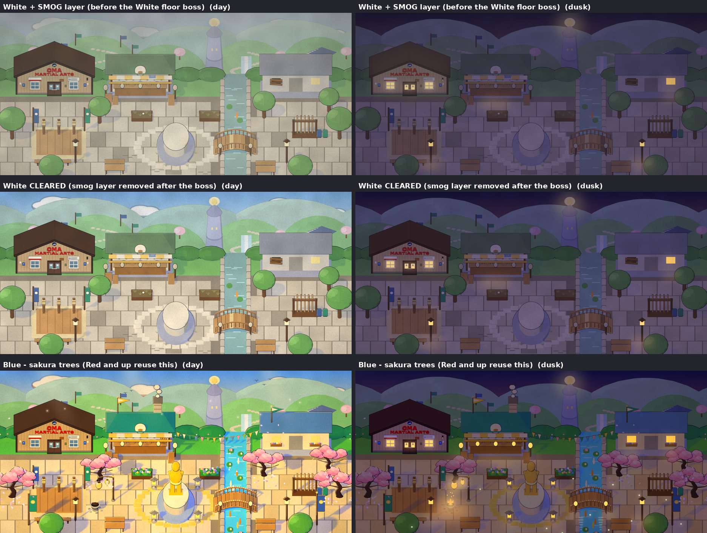

# Town Growth v5: five steps from run down to FULLY MAXED, then the Blue picture for good (A-TOWN-GROWTH)

Jay's direction (Nov 1): the town changes were not special enough. New arc: town growth is **capped at Blue**. White is a little run down, then the town climbs step by step (White, Yellow, Orange, Green, Blue) to a **fully maxed hero town at Blue**. Each step is meant to be a clear "wow, it changed" moment. **Red and above have no town art of their own: they reuse the Blue picture.** (The Content Designer owns a different mechanic for those belts.) **The gold flame is dropped.**

**v4 (Jay's feedback on v3):** (1) he likes the White smog, so the smog is now a **separate transparent layer** (day and dusk) that the game removes when the kid beats the White-belt floor boss; (2) Blue has **real sakura trees**; (3) Blue dusk is livelier: **12 fireflies, a fire bowl and two paper lanterns**. Green is unchanged from v3. v3 is in `superseded/v3-stages/`.

**v5 (Jay's feedback on the v4 sakura, Blue only):** the v4 sakura looked awkward and not blended with the other trees, so they are redrawn:
- **Same look as the other trees:** the same toon ramp, outline weight and outline colour. The trunks are thick and brown (outlined, not thin black).
- **Grounded:** each tree has a soft ground shadow, a **stone tree ring** (curb, soil and pebbles) and a few fallen petals underneath.
- **Dusk:** the pink is graded to the dusk palette (cooler, deeper rose) and gets a thin **warm rim** only on the sides that face a real source: the paper lanterns, the fire bowl and the lamp posts.
- **Five sakura, none in the walking lane.** The two round green bench trees are sakura now too. All trees stand fully below the lane strip (`source/check_lanes.py` checks 0 tree pixels in y 444-540 at @2x). A few **distant blossom trees** sit on the hills.
- **Smog:** it now **fades out after the White floor boss**, and the clear White picture (`1-white-*`) is the after-boss look (`stages.json` has a `fadeOut` entry).
- v4 Blue is in `superseded/v4-stages/`. `previews/compare-v4-v5-blue.png` shows v4 and v5 side by side.

Green is unchanged from v3. White is unchanged from v4 (the smog is the same layer).

**Samples only for now:** White (day, dusk and the smog layer), Green (unchanged), Blue (day and dusk), plus a sheet. Yellow and Orange are planned and not built.

Jump to: [Structure for the Programmer](#structure-for-the-programmer) | [The arc](#the-arc) | [Techniques used](#techniques-used-and-where-they-come-from) | [What is here](#what-is-here) | [How it is built](#how-it-is-built) | [Rules and checks](#rules-and-checks)

The sheet shows White **with** the smog layer on top (top row), White **clear** (middle row, the after-boss look) and Blue (bottom row), day on the left and dusk on the right.

## Structure for the Programmer

**One complete town background per belt, in a day and a dusk version, swapped whole by the highest belt. Nothing stacks, with ONE exception: the White smog layer (see below).**

1. Every picture is the whole town frame (1864x860 at @2x, 932x430 at 1x, the same frame and camera as the approved town square). It already has the sky, hills, Tower and **the Action Zone dojo drawn in its slot**.
2. Show the picture for the player's **own highest earned belt** (day or dusk to match the time of day). When the belt changes, **swap the whole picture**. Do not draw one belt on top of another.
3. Draw characters, effects and UI **on top**. The town art is only the background.
4. **Town art stops at Blue.** Red, Red/Black, Brown, Brown/Black and Black all show the **Blue** picture. In `stages/stages.json` those five belts are `"built": false, "useStage": "blue"` and have no `files`. Yellow and Orange are not built yet and say `"useUntilBuilt": "white"`.
5. Each phone draws its own town from its own belt. Other players never change it.

### The White smog layer (new in v4, for the Programmer)

The grey smog is **not baked into the White picture any more.** `stages/1-white-day*.png` and `1-white-dusk*.png` are the **clear-air** town (blue sky, bright). The smog is its own **full-frame transparent PNG**, same size as the background:

- Files: `stages/1-white-smog-day.png` / `1-white-smog-day@2x.png` and `1-white-smog-dusk.png` / `1-white-smog-dusk@2x.png` (RGBA, 932x430 and 1864x860). Listed in `stages.json` under the White entry's `smogOverlay`.
- **Draw order:** White background (day or dusk) -> **smog layer (same day or dusk)** -> characters, effects and UI. The smog sits over the town art and **under** characters and UI, so the kid and their friends are never fogged.
- **Show it only on White, and only until the White-belt floor boss is beaten.** When the kid beats that boss, **stop drawing the layer**: the clear White picture underneath is the town. **Fade it out:** when the boss is beaten, ease the layer's opacity from 1 to 0 (about 2.5 s is a suggestion), then stop drawing it. `stages.json` has the same rule under `smogOverlay.fadeOut`. The clear White (`1-white-*`) is the after-boss look. Never draw it on any other belt.
- **Look:** base + layer is made to match the v3 smoggy White that Jay liked (mean error 1.7/255 day and 0.9/255 dusk against the v3 look). `previews/1-white-with-smog-{day,dusk}[@2x].png` are the exact composites for review.
- It is a soft haze with no town detail baked in, so it lines up with the background by simply drawing both at (0,0), no scaling differences.

`stages/stages.json` is the lookup: per belt `order`, `belt`, `built`, `statue`, `notes`, and either `files` (day and dusk, @2x and 1x), `useStage` (Red to Black: use Blue) or `useUntilBuilt`.

## The arc

| # | Belt | The "wow" | Statue | Status |
|---|---|---|---|---|
| 1 | White | A little run down but friendly. **With the smog layer on:** the v3 look Jay liked (cool grey overcast, faded colours, weak shadows). **Smog faded out (after the floor boss, the after-boss look):** blue sky and clearer, brighter colour. Either way: a boarded window and a patched awning, a patched bridge plank, weedy empty beds, murky water with one koi, cracked stones, **an empty plinth**. Lamp posts and the dojo and shop windows are lit at dusk; the tall lanterns are off. | No (empty plinth) | **built** (clear base + smog layer) |
| 2 | Yellow | The clean-up: boards and patches gone, tidy beds, water clearer, first colour coming back. | No | planned, not built (until then show White) |
| 3 | Orange | The shop opens: chimney, warm lights, a fuller town (about the approved concept level). | No | planned, not built (until then show White) |
| 4 | Green | **Clearly upgraded.** Sky turns bright blue, fresh vivid grade, warm cream paving, **the statue is unveiled** with two stone lanterns (lit at dusk), lush flower beds, window boxes, blossoming hedges, bunting across the river, a gold roof flag, a bridge garland, one more koi, soft cast shadows and a thin warm rim light. | Yes | **built** |
| 5 | Blue | **FULLY MAXED hero town (the last town picture).** Golden-hour grade with violet shadows and long soft shadows, **five sakura trees** (v5: same toon shading and outline as the other trees, thick brown trunks, soft pink cloud clumps, each in a stone tree ring with a soft ground shadow, fallen petals and a few falling ones; all clear of the walking lane; the two bench trees are sakura too; a few distant blossom trees on the hills), **four stone lanterns** around the statue, **two tall banners** and **two roof flags**, a bigger bunting line, a golden paving ring, lotus flowers and more koi and lily pads, chimney smoke, sun shafts and motes, bloom on the statue and lanterns. At dusk: the pink grades to a deeper, cooler rose with a warm rim from the lanterns and fire bowl, **12 fireflies, a fire bowl and two paper lanterns on a hook post** (all glowing from real sources), the stone lanterns and falling petals. | Yes | **built** |
| 6 | Red | **Use the Blue picture.** No town art of its own. | Yes | use Blue |
| 7 | Red/Black | **Use the Blue picture.** | Yes | use Blue |
| 8 | Brown | **Use the Blue picture.** | Yes | use Blue |
| 9 | Brown/Black | **Use the Blue picture.** | Yes | use Blue |
| 10 | Black | **Use the Blue picture.** | Yes | use Blue |

No gold flame, no extra effects: town growth is finished at Blue.

## Techniques used (and where they come from)

Looked up before building, and copied where they fit this frame:

1. **A coherent colour grade per stage** (Pokemon, Club Penguin, Slay the Spire). White (with the smog layer) is desaturated and cool grey with a heavier vignette; the clear White underneath is lighter and bluer. Green is fresh and vivid. Blue is warm golden hour with violet shadows. One grade, one mood, per step, so each step reads as a new "place".
2. **Warm, saturated, readable palettes and clean shapes** (Pokemon, Club Penguin). Cream paving, strong greens, blossom pink, gold. Every prop keeps a simple silhouette.
3. **Crisp dark outlines** (Archero, Survivor.io). The approved toon outline (inverted hull) is kept on everything.
4. **Soft cast shadows plus ambient occlusion** (Archero, Survivor.io drop shadows). A separate clay render of the town lit by one sun gives soft shadows that fall up and right, cooler on the ground, lighter on props. The sun gets lower in later stages (longer shadows at Blue).
5. **Painterly light and rim light** (Slay the Spire). Lit surfaces get a warm tint, shadows a cool tint. A thin warm **rim line** runs along edges that face the light (from a height render of the scene), so roofs, hedges, props and paving edges "pop" off the ground.
6. **Play space vs scenery contrast** (Archero, Survivor.io). The back lawn, hills and hedges are about 6% darker and cooler than the plaza, and a soft vignette pulls the eye to the plaza where characters walk.
7. **Bloom on a few hero props only** (Pokemon, Club Penguin). Just the statue (richer gold, a soft halo) and the stone lanterns. Nothing else glows in the day.
8. **Banners, flags and bunting.** Roof flags, two tall banners and a bunting line across the river, in teal, blue, gold and cream (no red).
9. **Painterly texture.** Faint low-frequency blotches and a fine grain take the flat 3D look off the surfaces. Soft painted clouds and a per-stage sky (flat grey, bright azure, peach golden hour).
10. **Ambient-ready elements** (all stay static in the picture, but are built as separate shapes so the Programmer can animate later): bunting, flags and banners (wave), cherry petals (drift), chimney smoke (rise), koi and lotus (move), lantern flames (flicker), motes and fireflies (float).
11. **Subtle dusk.** Same picture, then a gentle dusk grade. Glow comes only from lit windows, stone lanterns, lamp posts, the shop and the Tower. Blue only: 12 fireflies, a fire bowl and two paper lanterns.

## What is here

| Path | What |
|---|---|
| `stages/1-white-day.png`, `...-dusk.png` (and `@2x`) | White backgrounds, **clear air (no smog)** |
| `stages/1-white-smog-day.png`, `...-dusk.png` (and `@2x`) | **The White smog layer** (transparent RGBA, drawn over the White background until the White floor boss is beaten) |
| `stages/4-green-day.png`, `...-dusk.png` (and `@2x`) | Green backgrounds |
| `stages/5-blue-day.png`, `...-dusk.png` (and `@2x`) | Blue backgrounds, **also used for Red to Black** |
| `stages/stages.json` | The belt-to-picture lookup (Red to Black = use Blue) |
| `previews/compare-v4-v5-blue.png` | **v4 and v5 Blue side by side**, day and dusk, plus detail crops of the left corner |
| `superseded/v4-stages/` | v4 Blue pictures, v4 sheet and v4 scripts (kept, not deleted) |
| `previews/samples-sheet.png` | White with smog, White cleared and Blue, day left and dusk right |
| `previews/1-white-with-smog-day.png`, `...-dusk.png` (and `@2x`) | The White background with the smog layer on top, for review only (the game composites the two itself) |
| `source/` | The build scripts |
| `superseded/` | The first overlay set, the v2 set and the **v3 set** (`v3-stages/`: the v3 White with the smog baked in, the v3 Blue with round pink trees, the v3 sheet, scripts and docs), and the **v4 set** (`v4-stages/`: the v4 Blue with the first sakura, the v4 sheet and scripts). **Do not use.** Nothing was deleted. |
| `DELIVERY_NOTE.md` | Item, what, why, decide, next, the check results and the spec mismatches |

## How it is built

Run `bash incoming-art/town-growth/source/render_all.sh` from the repo root (Blender 4.2, Pillow, numpy and scipy; at most 2 Blender processes at once).

- `source/build_town_stage.py` (Blender) runs the approved town-square build and changes it for one stage (statue removed in White, wear in White, upgrades in Green and Blue). Seven passes per stage (Blue has two more: `trees`, the sakura incl. rings, for the ground shadows, the lane check and the dusk rim, and `bloom`, the blossom crowns only, for the dusk rose grade): `day`, `night` (dusk town), `lights` (mask of lit things, the source of every glow), `props` (mask of added objects, for the lanes check), `shade` (clay render under one sun: shadows), `height` (surface height: rim light) and `hero` (mask for bloom).
- `source/make_stages.py` (Pillow, numpy) builds the sky, clouds and hazy far hills, composites the town and the dojo sprite, applies shadows, rim, bloom, the stage grade, scenery contrast and the vignette, then the effects and the dusk step. It writes `stages/` and `stages.json`.
- `source/blue_extras.py` holds the positions of the Blue fire bowl, lantern post, 12 fireflies and the 5 sakura (`SAKURA`: position, scale, lean), shared by the Blender script and `make_stages.py`.
- The smog layer is fitted in `make_stages.py` (`fit_smog`): the clear White and the v3-style smoggy White are both built, then a soft translucent colour+alpha field is solved so that `base x (1 - alpha) + alpha x colour` reproduces the smoggy look.
- `source/check_lanes.py` fails the render if any sakura pixel is in the walking-lane strip (y 444-540 at @2x). `render_all.sh` runs it.
- `source/make_stages.py` also draws the sakura ground shadows, the petal carpet, the dusk rose grade + warm rim (`sakura_dusk`) and the distant hill blossoms (`blossom_far`).
- `source/make_sheet.py` makes the sheet and the v4/v5 comparison.

## Rules and checks

- Kid-friendly (ages 6+). Nothing is drawn above the characters' heads. **No red anywhere except the CMA sign's brand red.**
- Everything added stays out of the walkable lanes (the strip in front of the buildings and the bridge). In v5 **no tree is in that strip** (`source/check_lanes.py`). The river and the flower beds are exempt. Petals, shafts and motes stay out of that strip.
- Every glow has a real source (lit window, stone lantern, lamp post, shop, Tower, and in v4 the **fire bowl's flames and coals** and the **two paper lanterns**; fireflies are the usual exception). The smog layer is not a glow.
- The statue and plinth are the approved ones, unchanged. They are hidden before Green and shown from Green.
- The photos used as likeness reference are not in the repo.
- Results of the checks are in `DELIVERY_NOTE.md`.
