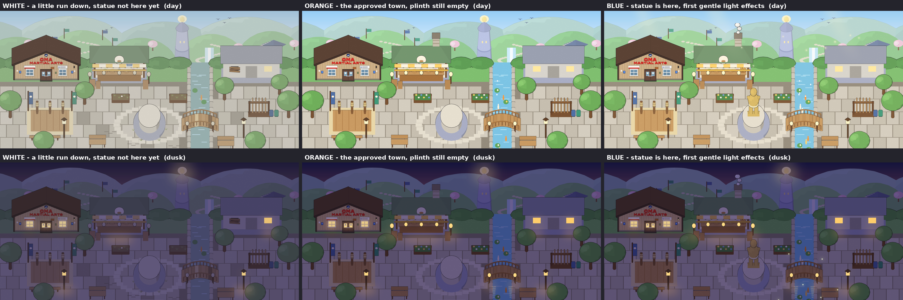

# Town Growth v2: one full town picture per belt (A-TOWN-GROWTH)

Jay's verdict on the first set was "too messy and cluttered", and he asked for a new arc where the town starts a little **run down** and gets nicer. Add-on overlays can only add things, so they cannot make a town that looks *worse* than the approved base. This set therefore uses a different structure (below).

**Samples only for now:** White, Orange and Blue, each in day and dusk. The other belts are planned but not built.

Jump to: [Structure for the Programmer](#structure-for-the-programmer) | [The arc](#the-arc) | [What is here](#what-is-here) | [How it is built](#how-it-is-built) | [Rules and checks](#rules-and-checks)

## Structure for the Programmer

**One complete town background per belt, in a day and a dusk version. Nothing stacks.**

1. Every picture is the whole town frame (1864x860 at @2x, 932x430 at 1x, the same frame and camera as the approved town square). It already has the sky, hills, Tower and **the Action Zone dojo already drawn in its slot**.
2. Show the picture for the player's **own highest earned belt** (day or dusk to match the time of day). When the belt changes, **swap the whole picture**. Do not draw one belt on top of another.
3. Draw characters, effects and UI **on top**, as before. The town art is only the background.
4. A belt that has no picture yet falls back to the nearest earlier built one (for the samples: Yellow shows White, Green shows Orange, and Red to Black show Blue). `stages/stages.json` lists every belt, which are built, and the file names.
5. Each phone draws its own town from its own belt. Other players never change it.

Why this structure: it is the simplest to use (one image lookup, no ordering rules), it can go below the base, and it avoids a pile of small overlays crowding the screen. The cost is file size (one background per belt per time of day instead of small overlays); at 10 belts that is 20 backgrounds. If size becomes a problem, the pictures can be cut into the same tile grid later.

`stages/stages.json` is the lookup: per belt `order`, `belt`, `built`, `statue`, `notes` and `files` (day and dusk, @2x and 1x).

## The arc

| # | Belt | Look | Statue | Status |
|---|---|---|---|---|
| 1 | White | A little run down but friendly: faded and worn colours, a boarded window, a patched awning stripe and a patched bridge plank, weedy empty flower beds, murky water with one koi, a few cracked stones near the plinth. Lamp posts and the dojo and shop windows are lit at dusk (the tall lantern posts are off). | No (empty plinth) | **built** |
| 2 | Yellow | A bit cleaner and more normal: boards and patches gone, beds tidy, water clearer. | No | planned |
| 3 | Orange | About the approved town concept art. Plus a shop chimney and a bread basket (no smoke). | No (empty plinth) | **built** |
| 4 | Green | The statue arrives on the plinth. | Yes | planned |
| 5 | Blue | Statue plus the first light effects, homely: a thin chimney smoke curl, two more koi and two more lily pads, a warm 5% tint, faint sun shafts and a few floating motes by day, a few fireflies near the river and hedges at dusk. | Yes | **built** |
| 6 | Red | One more gentle upgrade on Blue. Any flame is gold, never red. | Yes | planned |
| 7 | Red/Black | One more gentle upgrade. | Yes | planned |
| 8 | Brown | One more gentle upgrade. | Yes | planned |
| 9 | Brown/Black | One more gentle upgrade. | Yes | planned |
| 10 | Black | Out of scope in the content spec so far. Keep it gentle too. | Yes | planned |

Guard rails for Red to Black: a small change each time, never a screen full of effects, stay out of the walkable lanes, every glow has a source.

## What is here

| Path | What |
|---|---|
| `stages/1-white-day.png`, `...-dusk.png` (and `@2x`) | White backgrounds |
| `stages/3-orange-day.png`, `...-dusk.png` (and `@2x`) | Orange backgrounds |
| `stages/5-blue-day.png`, `...-dusk.png` (and `@2x`) | Blue backgrounds |
| `stages/stages.json` | The belt-to-picture lookup |
| `previews/samples-sheet.png` | The 3 stages side by side, day on top and dusk below |
| `source/` | The build scripts |
| `superseded/` | The first (add-on overlay) set, kept for reference. **Do not use it.** Nothing was deleted. |
| `DELIVERY_NOTE.md` | Item, what, why, decide, next, and the check results |

## How it is built

Run `bash incoming-art/town-growth/source/render_all.sh` from the repo root (Blender 4.2 and Pillow; at most 2 Blender processes at once).

- `source/build_town_stage.py` (Blender) runs the approved town-square build, then changes it for one stage: the statue and star are removed for White and Orange, the sparkles are thinned, and the stage's wear or extras are added. It renders four passes: `day`, `night`, `lights` (a mask of the lit windows and lanterns, the source of every glow) and `props` (a mask of only the added objects, used for the lanes check).
- `source/make_stages.py` (Pillow) adds the sky, hazy far hills and Tower, the White "worn" grade, the dusk grade, the soft light, the Blue effects, and pastes the Action Zone dojo sprite exactly as `action-zone-dojo/source/make_town_preview.py` does. It writes `stages/` and `stages.json`.
- `source/make_sheet.py` makes the side-by-side sheet.
- With no changes, the same pipeline reproduces the approved day picture pixel for pixel (checked), so Orange is the approved town and nothing else.

**Dusk is much gentler than the approved dusk.** Window and lantern glow is about a quarter of the old strength, the ground light pools about a third, the Tower light is fainter, there is no firefly swarm (Blue has only a few), and the dojo sprite's own door pools are turned down to match. Every glow still comes from a lit window, lantern or the Tower.

## Rules and checks

- Kid-friendly (ages 6+). Nothing is drawn above the characters' heads. No red anywhere except the CMA sign's brand red (the Red belt uses a gold flame).
- The added objects stay out of the walkable lanes (the strip in front of the buildings and the bridge). White's weeds and cracks are only on the flower beds and around the plinth.
- The statue and plinth are the approved ones and unchanged. They are hidden before Green and shown from Blue.
- The photos used as likeness reference are not in the repo.
- Results of the checks are in `DELIVERY_NOTE.md`.
